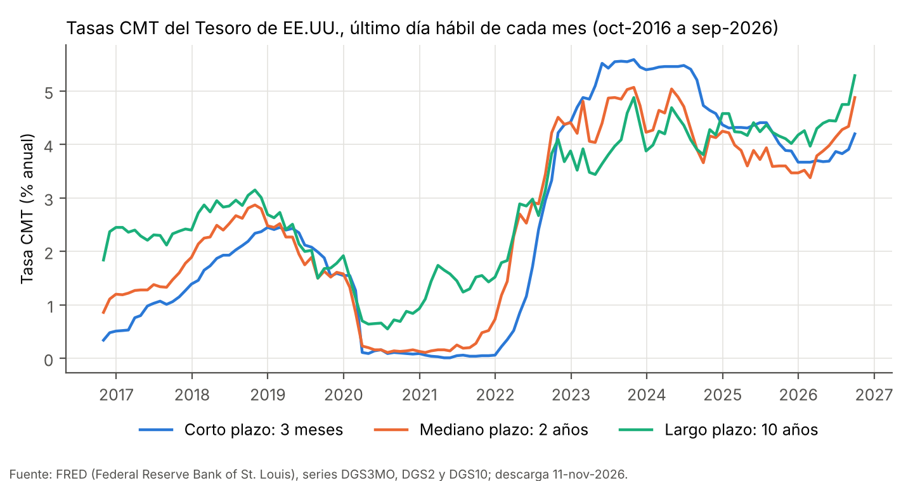
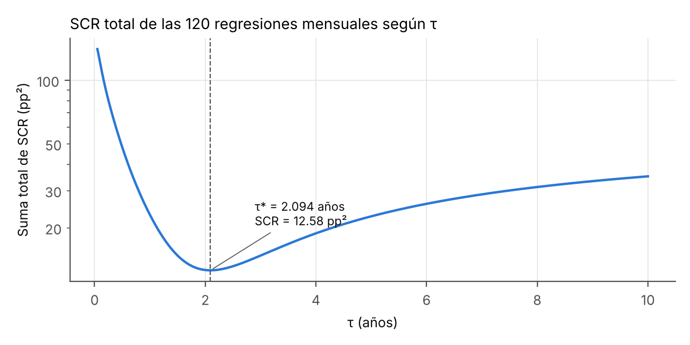
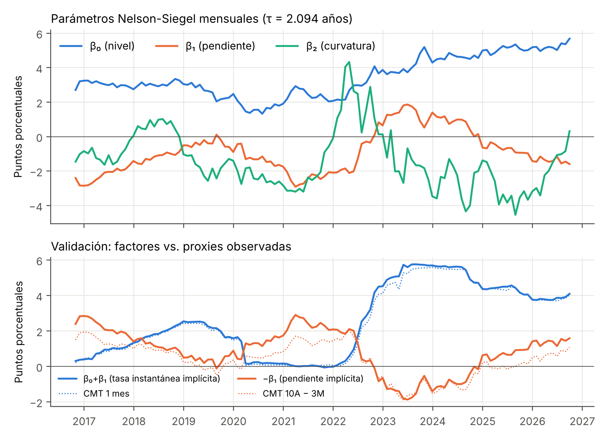
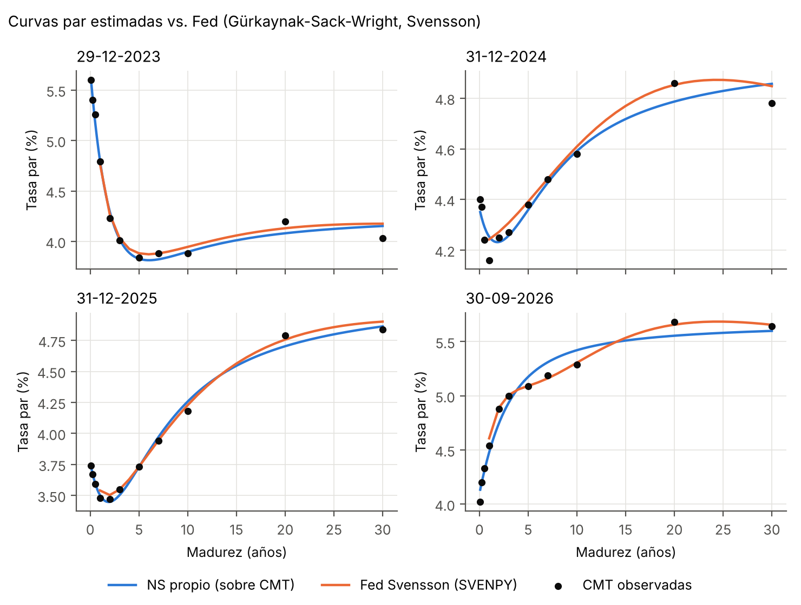

# Módulo I — Estimación de la estructura de tasas de interés en dólares

> Borrador de la sección del informe. Código: `src/module1_curves.py`. Datos originales en `data/raw/` (descarga 11-nov-2026). Figuras en `output/figs/`.

## Pregunta 1 — Qué son las tasas CMT

Las tasas **CMT** (*Constant Maturity Treasury*) que publica el Tesoro de EE.UU. y replica FRED (series `DGS*`) **no son tasas cero cupón**. Son **rendimientos al valor par** (*par yields*) que se leen sobre una curva ajustada diariamente por el Tesoro. Para cada madurez, la CMT es la tasa cupón que tendría un bono del Tesoro hipotético con ese plazo exacto si se transara a la par (precio = 100). Por eso existe una tasa a 10 años aunque ningún bono vigente tenga exactamente 10 años al vencimiento.

- **Instrumentos detrás.** Son las emisiones más recientemente subastadas (*on-the-run*):
  - *bills* de 4, 6, 8, 13, 17, 26 y 52 semanas, que son letras de descuento sin cupón;
  - *notes* de 2, 3, 5, 7 y 10 años;
  - *bonds* de 20 y 30 años.
- **Cupones.** Las *notes* y *bonds* pagan cupón **semestral**, así que las CMT de 1 año en adelante son tasas par con composición semestral. Los *bills* no pagan cupón: su tasa de descuento bid se convierte a **rendimiento equivalente a bono** (*bond-equivalent yield*). Por eso FRED rotula las series como *"quoted on an investment basis"*.
- **Información usada.** Son cotizaciones **indicativas del lado comprador** (*bid*) de esos títulos, no transacciones efectivas. Las recoge el **Federal Reserve Bank of New York cerca de las 15:30 (hora de Nueva York)** de cada día hábil.
- **Construcción de la curva.**
  1. Los precios se convierten a rendimientos.
  2. Se obtienen por *bootstrap* las tasas forward instantáneas en los puntos de entrada, de modo que cada título queda valorizado sin error.
  3. Esas forwards se interpolan con un **spline monótono convexo** (*monotone convex*, MC).

  El Tesoro usa este método desde el **6-dic-2021**. Antes usaba un **spline Hermite cuasi-cúbico** (HS), que tomaba los rendimientos de mercado directamente como si fueran una curva par. Las CMT publicadas tienen piso en cero.

**Consecuencia para este trabajo.** Como las CMT son *par yields*, una curva Nelson-Siegel ajustada sobre ellas es una **curva par**, no una curva cero cupón. Las CMT de 1, 3 y 6 meses provienen de instrumentos sin cupón, así que en el tramo corto la curva mezcla convenciones. El efecto es menor, pero se reporta como limitación.

*Fuente:* U.S. Department of the Treasury, *Treasury Yield Curve Methodology* (rev. 18-feb-2025) y *Yield Curve Methodology Change Information Sheet*.

## Pregunta 2 — Datos

Se descargaron desde FRED (Federal Reserve Bank of St. Louis) las series diarias:

| Serie FRED | DGS1MO | DGS3MO | DGS6MO | DGS1 | DGS2 | DGS3 | DGS5 | DGS7 | DGS10 | DGS20 | DGS30 |
|---|---|---|---|---|---|---|---|---|---|---|---|
| Madurez *m* (años) | 1/12 | 0,25 | 0,5 | 1 | 2 | 3 | 5 | 7 | 10 | 20 | 30 |

Se excluyen las series de 1,5, 2 y 4 meses porque no cubren el período completo.

- **Selección del dato mensual.** Para cada mes entre oct-2016 y sep-2026 se tomó el último dato hábil disponible. En los 120 meses las 11 series coinciden en la misma fecha y no faltan valores.
- **Tamaño.** Resulta un panel balanceado de **120 meses × 11 madureces = 1.320 observaciones**, en `data/raw/fred_cmt_monthly_eom_2026-11-11.csv` (formato ancho) y `data/processed/cmt_long.csv` (formato largo).
- **Descarga.** Se hizo desde el endpoint `fredgraph.csv` de FRED el 11-nov-2026. No se usó `fredapi`, porque no requiere clave. Se verificó con sumas de control que el archivo coincide con la fuente.

## Pregunta 3 — Tasas de corto, mediano y largo plazo

*Figura 1. Tasas CMT de 3 meses (corto plazo), 2 años (mediano) y 10 años (largo), al último día hábil de cada mes, oct-2016 a sep-2026. Fuente: FRED.*

Se eligieron estas tres madureces porque cada una representa a su tramo:

- **3 meses:** ancla de la tasa de política monetaria de la Reserva Federal (Fed).
- **2 años:** expectativas de política para el mediano plazo.
- **10 años:** referencia de largo plazo.

El gráfico muestra cinco episodios:

1. **2017–2018:** alzas graduales de la Fed y aplanamiento de la curva.
2. **2019:** inversión de la curva y recortes de tasas.
3. **Marzo 2020:** caída al límite inferior cero (*zero lower bound*) por el COVID-19, con un 10 años que repunta desde 2021.
4. **2022–2023:** el ciclo de alzas más rápido en décadas y una inversión profunda (3M > 2A > 10A) que dura hasta 2024.
5. **2024–2026:** recortes en el corto plazo y desinversión. En 2026 la curva vuelve a tener pendiente positiva con alza en todos los plazos. Entre dic-2025 y sep-2026, el 10 años sube de 4,18% a 5,29% (+111 pb) y el 5 años de 3,73% a 5,09% (+136 pb).

Ese último episodio es clave para el Módulo III, porque un alza de tasas largas en USD reduce el valor de las posiciones que reciben tasa fija.

## Pregunta 4 — Nelson-Siegel con τ = 1 año

Para cada mes *t* se estima por mínimos cuadrados ordinarios (MCO):

$$y_t(m) = \beta_{0t} + \beta_{1t}\,\underbrace{\frac{1-e^{-m/\tau}}{m/\tau}}_{L_1(m)} + \beta_{2t}\,\underbrace{\left(\frac{1-e^{-m/\tau}}{m/\tau} - e^{-m/\tau}\right)}_{L_2(m)} + \varepsilon_t(m)$$

**Interpretación de los parámetros:**

- **β₀ (nivel):** es el límite de *y*(*m*) cuando *m* → ∞, es decir, la tasa de muy largo plazo.
- **β₁ (pendiente):** su carga L₁ vale 1 en *m* = 0 y decae a 0. Por eso β₀ + β₁ es la tasa instantánea (*m* → 0) y −β₁ es la diferencia entre el largo y el corto plazo.
- **β₂ (curvatura):** su carga L₂ vale 0 en los extremos y tiene un máximo interior, que genera jorobas (si β₂ > 0) o valles (si β₂ < 0).

**Por qué es MCO.** Con τ fijo, las cargas son regresores conocidos y el modelo es lineal en (β₀, β₁, β₂). Cada mes es una regresión de 11 observaciones con 3 parámetros. No se reparametriza con λ = 1/τ.

**Resultado de validación (τ = 1 año):**

| τ (años) | SCR total (pp²) | N observaciones | N regresiones | RMSE (pb) |
|---|---|---|---|---|
| 1,000 | **23,058** | **1.320** | 120 | 13,2 |

- **SCR** = suma de cuadrados de los residuos, en puntos porcentuales al cuadrado (pp²).
- **RMSE** = raíz del error cuadrático medio, √(SCR/N), en puntos base (pb).

## Pregunta 5 — τ óptimo

**Procedimiento:**

1. Se construyó una grilla τ ∈ [0,05; 10] años con paso 0,01.
2. Para cada τ se recalcularon las 120 regresiones y se sumaron sus SCR.
3. El mínimo de la grilla (τ = 2,09) se refinó con optimización acotada entre los nodos vecinos.

| Especificación | τ (años) | SCR total (pp²) | N observaciones | RMSE (pb) |
|---|---|---|---|---|
| Validación (Q4) | 1,000 | 23,058 | 1.320 | 13,2 |
| **Óptimo (Q5)** | **2,094** | **12,581** | **1.320** | **9,8** |

*Figura 2. Suma total de los SCR mensuales según τ (escala logarítmica).*

**Lectura de los resultados:**

- La función SCR(τ) tiene un **mínimo interior único**, sin óptimos locales en la grilla. Esto confirma que el óptimo no depende del punto de partida.
- Pasar de τ = 1 a τ* = 2,094 **reduce el SCR total en 45%** y el error típico de 13 a 10 pb.
- Con τ* = 2,094, la carga de curvatura alcanza su máximo cerca de *m* ≈ 1,79·τ ≈ **3,8 años**. Es decir, la joroba o valle se ubica en el tramo de 2 a 5 años, donde la curva estadounidense concentró su curvatura en la muestra (inversión 2022–2024).
- Un τ menor ubica la curvatura en plazos muy cortos y empeora el ajuste de 5 a 10 años. Un τ mayor no captura la convexidad entre 1 y 5 años.

## Pregunta 6 — Evolución de β₀, β₁ y β₂

*Figura 3. Panel superior: parámetros NS mensuales (τ = 2,094 años). Panel inferior: validación de los factores contra sus contrapartes observadas.*

**Validación (panel inferior):**

- **β₀ + β₁ (tasa instantánea implícita)** reproduce casi exactamente la CMT de 1 mes en toda la muestra. Captura el *zero lower bound* de 2020–2021, el ciclo de alzas 2022–2023 y los recortes desde fines de 2024.
- **−β₁ (pendiente implícita)** sigue la dirección y los cambios de signo del diferencial CMT 10A − 3M. El nivel es mayor porque −β₁ mide la pendiente entre *m* → ∞ y *m* → 0, no entre 10 años y 3 meses.

**Lectura de los parámetros (panel superior):**

- **Nivel β₀:** oscila entre 2,5% y 3,3% hasta 2019, cae a ~1,4% en 2020 y sube hasta **5,7% en sep-2026**, su máximo de la muestra. El alza de 2026 es un movimiento del **nivel** de la curva larga.
- **Pendiente β₁:** es negativa (curva con pendiente positiva) salvo en dos períodos. Se vuelve positiva en el segundo semestre de 2022 y hasta 2024, que es el período de curva invertida. Vuelve a ser negativa desde 2025.
- **Curvatura β₂:** toma valores positivos grandes en 2022 (máximo 4,3 pp). La curva tenía una joroba en el tramo 2–5 años mientras el mercado incorporaba alzas que aún no llegaban a la tasa corta. Es negativa en 2024–2025 (valle en 1–3 años, por los recortes esperados) y converge a cero en 2026.

**Peores ajustes mensuales:**

- **Jun-2022 y ago–nov-2022** (SCR de 0,6 a 0,8 pp²): la curva cambiaba de forma muy rápido.
- **Abr-2023** (SCR 0,81): la CMT de 1 mes (4,35%) quedó bajo la de 3 meses (5,10%) por la distorsión del techo de deuda sobre los *bills* cortos. Un modelo de 3 factores no puede reproducir ese quiebre.

La dinámica de los tres factores es coherente con la historia de tasas y con la interpretación de nivel, pendiente y curvatura.

## Pregunta 7 — Comparación con las curvas par Svensson de la Fed (SVENPY)

Se extrajeron de `feds200628.csv` (Federal Reserve Board, Gürkaynak, Sack y Wright, 2007) las tasas par SVENPY01–SVENPY30 para el 29-dic-2023, el 31-dic-2024, el 31-dic-2025 y el 30-sep-2026.

*Figura 4. Curva par Nelson-Siegel propia (τ = 2,094) vs. curva par Svensson de la Fed, con las CMT observadas.*

**Diferencias NS − SVENPY, madureces de 1 a 30 años (pb):**

| Fecha | Media | Media absoluta | Máx. absoluta (madurez) | 2A | 5A | 10A | 20A | 30A |
|---|---|---|---|---|---|---|---|---|
| 29-12-2023 | −3,9 | 4,3 | 5,9 (6A) | +2,7 | −5,4 | −4,9 | −5,0 | −2,3 |
| 31-12-2024 | −3,6 | 3,8 | 6,6 (19A) | −3,9 | −3,3 | −1,8 | −6,6 | +0,9 |
| 31-12-2025 | −2,5 | 3,7 | 6,0 (23A) | −5,5 | −0,2 | +2,9 | −5,3 | −3,8 |
| 30-09-2026 | −2,5 | 8,8 | 15,0 (8A) | −14,4 | +8,3 | +11,5 | −10,2 | −5,7 |

**Diferencias principales:**

1. **Coincidencia general alta.** En las tres primeras fechas las curvas difieren en 4 pb en promedio absoluto y nunca en más de 7 pb. Las formas coinciden: valle en 5–7 años en dic-2023, curva con forma de "S" en dic-2024 y valle en 2 años con pendiente positiva en dic-2025.
2. **Tramo largo.** La curva propia queda sistemáticamente bajo la de la Fed en 15–25 años. Con un solo factor de curvatura, NS no puede generar la segunda joroba que Svensson sí permite con su cuarto término (β₃, τ₂). Desde 2020, el 20 años de las CMT suele estar sobre el 30 años, y NS impone un acercamiento monótono hacia β₀.
3. **Sep-2026, la peor fecha.** La curva combina un tramo corto muy empinado (1M–2A: de 4,0% a 4,9%) con una segunda joroba en 20–25 años. NS con τ único suaviza ambos rasgos: subestima el 2 años en 14 pb y sobrestima el 8–10 años en 11–15 pb. Esto importa para el Módulo III, porque los errores de esa magnitud en 2–10 años están en el tramo donde se concentran los swaps.
4. **Diferencias en los datos de entrada.** Gürkaynak, Sack y Wright (GSW) estiman sobre precios de notas y bonos fuera de circulación (*off-the-run*), excluyen los *bills* y las emisiones *on-the-run*, y luego convierten la curva cero a tasas par. Por eso SVENPY01 no está anclado a la CMT de 1 año: en sep-2026 vale 4,61% vs. 4,54%. Nuestra curva, en cambio, ajusta directamente las tasas par *on-the-run*. Las emisiones *on-the-run* tienen una prima de liquidez, así que se esperan diferencias de pocos puntos base aun con un ajuste perfecto.

**Conclusión del módulo.** La curva NS con τ* = 2,094 reproduce bien el nivel y la forma de la curva par en dólares, con un error típico de ~10 pb respecto de las CMT y de ~4 pb respecto de la Fed en fechas normales. El error es mayor en 2026, cuando la curva tiene dos jorobas. Esta curva se usa en el Módulo III para valorizar los swaps, y el error de ajuste se suma a las limitaciones de usar una curva del Tesoro para swaps SOFR.
